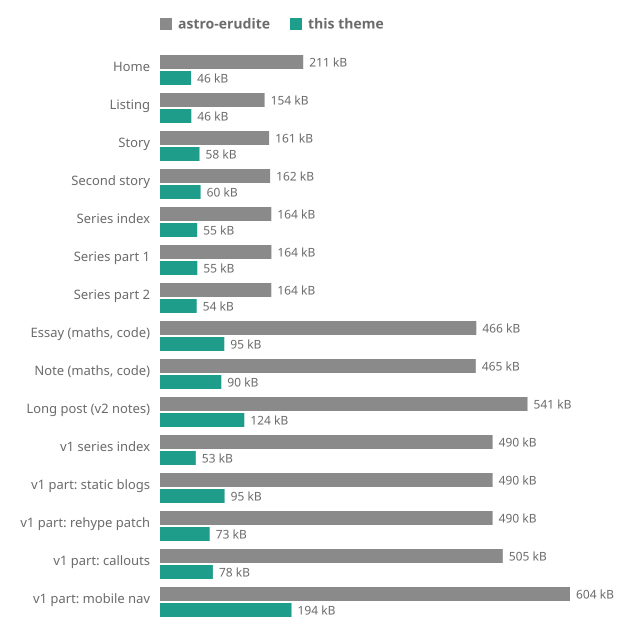
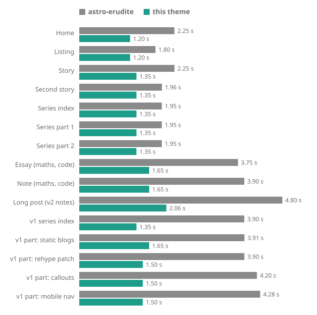
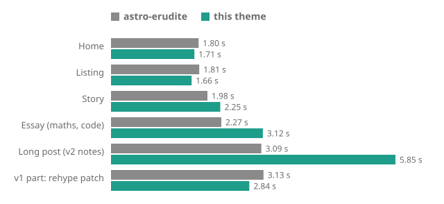

THIS CONTENT IS ENTIRELY LLM WRITTEN

This theme is built on astro-erudite and adds a build-time line breaker, margin notes and citations. To see what that costs and buys, both themes build the same fifteen pages here, and the comparison covers what a browser downloads, how soon it paints and what Lighthouse scores.[^scope]

## The same content on both

Comparing one theme's demo site with another's says nothing, because the demos hold different posts. So every page below is the same markdown rendered by each theme. The fifteen pages are this example site's nine pages, plus the long v2 announcement and the v1 series, an index and four posts, that ship as astro-erudite's own demo content. That second set matters because it has images and long code blocks, which this site's own pages lack.

The posts were changed only where one theme cannot render them:

- Citations are stripped, since astro-erudite has none.
- The banner image in each astro-erudite post's front matter is dropped, since this theme has no banner. That makes astro-erudite slightly lighter than it ships.
- Version tags such as `v1.6.0` are dropped on both sites, and links between posts point at each site's own routes.
- astro-erudite keeps its required author byline, which this theme removes.

Both sites use IBM Plex Sans, which astro-erudite ships as variable font files and this theme as static instances subset to the glyphs the site uses. Everything else that differs is the theme, and is part of the answer.

## Summary

Medians across the fifteen pages, on Lighthouse's simulated phone:

| Measure | astro-erudite | This theme | Difference |
| --- | ---: | ---: | --- |
| Bytes sent per page | 465 kB | 60 kB | 7.8 times smaller |
| Fonts sent per page | 442 kB | 35 kB | 12.7 times smaller |
| All fifteen pages, each loaded cold | 5,233 kB | 1,176 kB | 4.4 times smaller |
| First paint | 2.78 s | 1.05 s | 2.6 times faster |
| Largest paint | 3.75 s | 1.35 s | 2.8 times faster |
| Performance score | 84 | 100 | 16 points higher |
| Accessibility score | 96 | 100 | 4 points higher |

The theme sends fewer bytes and paints its largest element sooner on all fifteen pages. It is not faster in every measurement. When the browser is really throttled it paints first content later on three of six pages, it blocks the main thread for 35 to 80 ms on five pages where astro-erudite blocks for none on the simulated phone, and it makes more requests on eight pages.

## Page weight



The theme sends 46 to 194 kB per page and astro-erudite 154 to 604 kB. Fonts are most of the gap: 142 to 484 kB on astro-erudite against 35 to 59 kB. The two sites send about the same images (114 kB against 117 kB across all fifteen pages), so images do not explain it.

## Largest paint



The largest paint arrives 0.6 to 1.05 s sooner on the plain pages and 2.1 to 2.8 s sooner on the illustrated posts and the pages with maths and code. First paint is earlier on twelve pages, level on two and later on one, the listing, by 0.15 s.

## Lighthouse scores

Medians of 11 runs per page and site:

| Category | astro-erudite | This theme |
| --- | --- | --- |
| Performance | 76 to 100, below 90 on eight pages | 100 on thirteen pages, 99 and 98 on two |
| Accessibility | 95 or 96 on ten pages, 100 on five | 100 on fourteen pages, 96 on one |
| Best practices | 100 on fourteen pages, 96 on one | 100 on every page |
| SEO | 100 on eleven pages, 92 on four | 100 on every page |
| Layout shift | 0.041 on one page, 0 on the rest | 0 on every page |

The scores are whole numbers and most are identical across the 11 runs, so a median says more than an interval would. The two pages where the theme falls short of 100 are the long v2 post (98, with a largest paint of 2.06 s) and the static blogs post (99).

## Where the theme is slower

Three things go against the theme.

On the simulated phone it records 35 to 80 ms of blocking time on five pages (the long post and four of the illustrated posts) where astro-erudite records none. I did not isolate the cause.

It makes more requests on eight pages, such as 21 for the essay against 13, because the line breaker, margin notes and citations bring their own scripts and styles.

On the listing, astro-erudite paints first content earlier, 0.90 s against 1.05 s.

### Real throttling

Lighthouse's default mobile score models the page load instead of slowing the browser. Applied throttling slows a real browser to the same 1.6 Mbps link and 150 ms round trips. I audited six of the pages 5 times each this way.



| Page | Performance | First paint | Blocking time |
| --- | --- | --- | --- |
| Story | 97 against 96 | 1.98 s against 2.25 s | 124 ms against 0 |
| Listing | 98 against 99 | 1.81 s against 1.66 s | 83 ms against 0 |
| Home | 98 against 99 | 1.80 s against 1.71 s | 61 ms against 0 |
| Essay | 85 against 88 | 2.27 s against 3.12 s | 342 ms against 0 |
| Long post | 67 against 68 | 3.09 s against 5.85 s | 964 ms against 27 ms |
| v1 rehype patch | 65 against 91 | 3.13 s against 2.84 s | 655 ms against 0 |

In each cell the astro-erudite figure comes first. Under real throttling the theme scores higher on five of the six pages, because astro-erudite blocks the main thread for 61 to 964 ms and the theme for 27 ms at most. It paints first content later on the story, the essay and the long post. The long post is the worst case, 2.8 s later.

The font preloads explain at least the story. In a separate test with them removed, its first paint under applied throttling fell from 2.01 s to 1.56 s, while under the simulated model the same change made it 0.45 s slower. A preload starts a font as soon as the HTML arrives, which the simulation rewards because it charges for every round trip. On a real 1.6 Mbps link the roughly 50 kB of fonts compete with the stylesheets for bandwidth. Switching `font-display` from `block` to `swap` changed nothing, so invisible text is not the cost. I did not trace the long post.

The theme keeps `block` and the preloads because the line breaker measures paragraphs with the real font files, and text set in a fallback face would not fit its breaks.

## Reading every page

A reader who opens all fifteen pages downloads each shared file once. That is 344 kB across 41 files on the theme and 946 kB across 34 files on astro-erudite.

| Files loaded once across the fifteen pages | astro-erudite | This theme |
| --- | ---: | ---: |
| HTML | 305.4 kB | 141.8 kB |
| Fonts | 513.9 kB | 58.5 kB |
| CSS | 7.8 kB | 19.1 kB |
| JavaScript | 3.8 kB | 7.1 kB |
| Images | 114.2 kB | 117.2 kB |

The theme is smaller in HTML and fonts, and larger in CSS and JavaScript.

## How it was measured

Everything is lab data, since an example site has no visitors to collect field data from. Following Google's advice on variability, conditions were held fixed and each result is a median of several runs [@lighthouse-variability].

- Lighthouse 13.5.0 drove headless Chromium with a fresh browser for every audit, so each starts cold.
- Each page was audited 11 times per site on the default mobile profile. Within a round the audits ran in shuffled order so that drift in the machine hits both sites alike, and one warm-up round was discarded. The runs came in two batches of 5 and 6 rounds, on the same builds and settings.
- The mobile profile uses simulated throttling: a 4x slower CPU and a 1.6 Mbps link with 150 ms round trips. The real-throttling check used the same link and CPU slowdown applied to the browser.
- Both builds were served by the same static server, which compresses text with Brotli and sends `Cache-Control: max-age=0`.
- Sizes are bytes on the wire after Brotli, from Lighthouse's network log.

## The line breaker

The line breaker runs when the site is built. For every justified paragraph it measures the text with the real font files, chooses the breaks and writes them into the page as a compact plan. The browser only applies the plan, which keeps the script to about 4 kB on the wire.[^plan] Doing the same work in the browser would mean shipping the font metrics and the algorithm to every reader and moving text after first paint.

The break search follows Knuth and Plass [@knuth1981]: it chooses all of a paragraph's breaks together to minimise the total looseness of its lines, instead of filling one line at a time.

## Accessibility

The theme's test suite runs an automated audit on every page of the example sites, in light and dark mode, and fails on any violation. Contrast is checked against WCAG 2.2 [@wcag22], which defines the contrast ratio of two colours from their relative luminances:

$$
\text{ratio} = \frac{L_1 + 0.05}{L_2 + 0.05}, \qquad L = 0.2126\,R + 0.7152\,G + 0.0722\,B
$$

Normal text needs a ratio of at least $4.5$, and large text and interface components at least $3$. The example uses astro-erudite's palette, so the contrast figures are the same for both sites:

| Pair | Light | Dark | Needed |
| --- | ---: | ---: | ---: |
| Body text on the page | 15.9 | 16.3 | 4.5 |
| Muted text and the flourish colour | 5.8 | 9.1 | 4.5 |
| Focus ring in astro-erudite | 1.9 | 3.0 | 3 |
| Focus ring in this theme | 3.7 | 4.5 | 3 |

Lighthouse scored astro-erudite 95 or 96 for accessibility on ten pages and 100 on five, and the theme 100 on fourteen. On the essay it flagged astro-erudite's tag links under the title for low contrast. Separately, astro-erudite's focus ring measures 1.9:1 in light mode against the 3:1 WCAG asks for, and the theme darkens it.

Justified text can open wide gaps between words. The theme measures the whole paragraph before choosing breaks to keep them small, and if its script is blocked the page falls back to the browser's own layout.

## Reproducing it

The sizes come from a short script that builds nothing. It reads an output directory and reports Brotli sizes by file type:

```js
import { brotliCompressSync } from 'node:zlib'
import { readdirSync, readFileSync, statSync } from 'node:fs'
import { extname, join } from 'node:path'

function sizes(directory, totals = {}) {
  for (const name of readdirSync(directory)) {
    const path = join(directory, name)
    if (statSync(path).isDirectory()) {
      sizes(path, totals)
      continue
    }
    const kind = extname(name)
    totals[kind] =
      (totals[kind] ?? 0) + brotliCompressSync(readFileSync(path)).length
  }
  return totals
}

console.log(sizes('dist'))
```

Run it against each site's `dist` directory and compare the totals. For the timings, serve each build with a Brotli static server and audit it with the Lighthouse command line, repeating each page and taking the median.

## Limits

The theme gives up some things for those numbers. It sends more CSS and JavaScript than astro-erudite, it makes more requests, and on a really slow link its first paint is later on some pages, by 2.8 s on the long post.

This is one machine, one set of posts and lab conditions. Differences of a point or two are noise. The numbers describe how the two themes treat the same markdown, not what a given site built on them will score.

[^scope]: The comparison says how the two themes treat the same markdown, not how every site built on them will behave.

[^plan]: A paragraph's plan is a list of numbers, one per line, encoded as text in an attribute on the paragraph. The browser reads it, sets each line's spacing and finishes.
